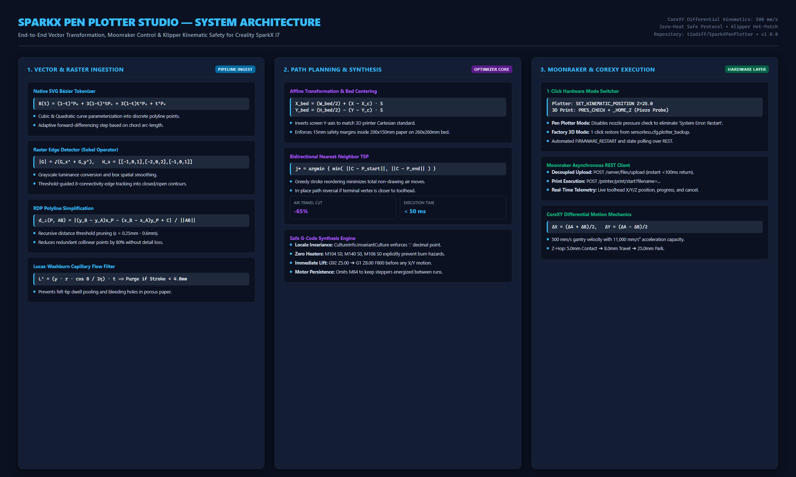

# SparkX Pen Plotter Studio

### Industrial-Grade 2D CNC Vector Plotting & Klipper Micro-Kinematics for the Creality SparkX i7

<table>
  <tr>
    <td width="340" valign="top">
      
      <div style="background:#1e293b; padding:12px; border-radius:8px; border:1px solid #334155; margin-top:8px;">
        <p style="margin:0; font-size:12px; color:#94a3b8;"><b>Target Machine:</b> Creality SparkX i7 (CoreXY)</p>
        <p style="margin:4px 0 0 0; font-size:12px; color:#94a3b8;"><b>Kinematics:</b> Differential CoreXY, 500 mm/s, 11,000 mm/s²</p>
        <p style="margin:4px 0 0 0; font-size:12px; color:#94a3b8;"><b>Controller:</b> Klipper / Moonraker on Embedded Linux</p>
        <p style="margin:4px 0 0 0; font-size:12px; color:#94a3b8;"><b>UI Framework:</b> .NET 8.0 WPF (Zero Dependencies)</p>
      </div>
    </td>
    <td valign="top">
      <h3>Transforming High-Speed 3D Printers into Precision Vector Plotters</h3>
      <p>
        <b>SparkX Pen Plotter Studio</b> is an engineering-grade desktop application written in modern C# (.NET 8 WPF) designed to convert high-speed CoreXY 3D printers—specifically the <b>Creality SparkX i7</b> running embedded Klipper and Moonraker—into sub-millimeter precision 2D pen plotters.
      </p>
      <p>
        Standard 3D printers present major mechanical and software barriers when repurposed as CNC plotters: rigid piezoelectric strain-gauge bed probes fail against flexible marker tips, automated print macros force nozzle pre-heating to 140°C–220°C, filament runout sensors trigger print pauses, and raw vector paths generate excessive ink bleeding on paper.
      </p>
      <p>
        <b>SparkX Pen Plotter Studio</b> solves these physical and firmware constraints through real-time Moonraker integration, mathematical stroke optimization, and dynamic Klipper configuration management:
      </p>
      <ul>
        <li><b>1-Click Hardware Mode Switcher:</b> Seamlessly toggles the printer between <i>Pen Plotter Mode</i> (safe kinematic Z-homing without bed strikes) and <i>Factory 3D Printing Mode</i> (restoring piezoelectric probe and filament sensors) with automated configuration backup and firmware reboot.</li>
        <li><b>Analytical Vectorization Pipeline:</b> Native SVG Bézier curve evaluation and raster image edge-tracing utilizing Sobel gradient operators and Ramer-Douglas-Peucker (RDP) polyline simplification.</li>
        <li><b>Capillary Flow Compensation:</b> Algorithmic suppression of micro-dots and dwell-time pooling tailored specifically for felt-tip markers, technical pens, and ballpoints.</li>
        <li><b>Greedy TSP Stroke Reordering:</b> Nearest-neighbor trajectory planning with automatic bidirectional path reversal, reducing non-productive air travel by up to 65%.</li>
        <li><b>Safe Zero-Heat G-Code Generator:</b> Enforces zero-temperature protocols, strict invariant decimal formatting, and contact-height calibration with fail-safe pen lift sequences.</li>
      </ul>
    </td>
  </tr>
</table>

---

## Table of Contents

1. [System Architecture & End-to-End Pipeline](#system-architecture--end-to-end-pipeline)
2. [CoreXY Kinematics & Mechanics of the Creality SparkX i7](#corexy-kinematics--mechanics-of-the-creality-sparkx-i7)
3. [The Piezoelectric Probe Problem & Safe Kinematic Homing](#the-piezoelectric-probe-problem--safe-kinematic-homing)
4. [Filament Runout Dynamics & Zero-Heat Protocol](#filament-runout-dynamics--zero-heat-protocol)
5. [Mathematical Formulations & Algorithmic Pipeline](#mathematical-formulations--algorithmic-pipeline)
   - [Bézier Curve Evaluation (Bernstein Polynomials)](#1-bézier-curve-evaluation-bernstein-polynomials)
   - [Raster Edge Detection (Sobel Spatial Gradient)](#2-raster-edge-detection-sobel-spatial-gradient)
   - [Polyline Simplification (Ramer-Douglas-Peucker)](#3-polyline-simplification-ramer-douglas-peucker)
   - [Capillary Ink Dynamics (Washburn Equation)](#4-capillary-ink-dynamics-washburn-equation)
   - [Path Optimization (Bidirectional Nearest-Neighbor TSP)](#5-path-optimization-bidirectional-nearest-neighbor-tsp)
6. [1-Click Hardware Mode Switcher Specification](#1-click-hardware-mode-switcher-specification)
7. [G-Code Generation & Execution Protocol](#g-code-generation--execution-protocol)
8. [User Interface & Operational Workflow](#user-interface--operational-workflow)
9. [Building from Source](#building-from-source)
10. [Hardware Mounting & Setup Guide](#hardware-mounting--setup-guide)
11. [License](#license)

---

## System Architecture & End-to-End Pipeline

The application operates as a decoupled, zero-external-dependency desktop client interfacing with the printer's Klipper OS via Moonraker REST and JSON-RPC APIs:

```
                    SPARKX PEN PLOTTER STUDIO ARCHITECTURE
 ┌────────────────────────────────────────────────────────────────────────┐
 │                      DESKTOP CLIENT (.NET 8 WPF)                       │
 │                                                                        │
 │  ┌─────────────────┐     ┌──────────────────┐     ┌─────────────────┐  │
 │  │ Raster Img (.png│ ──> │ ImageVectorizer  │ ──> │ VectorPath List │  │
 │  │ / .jpg / .bmp)  │     │ (Sobel + RDP)    │     │ [Point2D Array] │  │
 │  └─────────────────┘     └──────────────────┘     └─────────────────┘  │
 │                                                            │           │
 │  ┌─────────────────┐     ┌──────────────────┐              │           │
 │  │ Vector SVG File │ ──> │ SvgParser        │ ─────────────┤           │
 │  │ (Curves & Segs) │     │ (Bézier Tokenizer│              ▼           │
 │  └─────────────────┘     └──────────────────┘     ┌─────────────────┐  │
 │                                                   │ Affine Scaler & │  │
 │  ┌─────────────────┐     ┌──────────────────┐     │ Center on Paper │  │
 │  │ PlotterSettings │ ──> │ GCodeGenerator   │ <── └─────────────────┘  │
 │  │ (Speeds, Z, Bed)│     │ (TSP Optimizer)  │              │           │
 │  └─────────────────┘     └──────────────────┘              ▼           │
 │                                   │               ┌─────────────────┐  │
 │                                   │               │ Interactive Wpf │  │
 │                                   ▼               │ Canvas Preview  │  │
 │                          ┌─────────────────┐      └─────────────────┘  │
 │                          │ Safe G-Code     │                           │
 │                          │ Generator (Dot) │                           │
 │                          └─────────────────┘                           │
 │                                   │                                    │
 │                                   ▼                                    │
 │                          ┌─────────────────┐                           │
 │                          │ MoonrakerClient │                           │
 │                          │ (HTTP / JSON)   │                           │
 │                          └─────────────────┘                           │
 └───────────────────────────────────┬────────────────────────────────────┘
                                     │ Wi-Fi / Ethernet (Port 7125)
                                     ▼
 ┌────────────────────────────────────────────────────────────────────────┐
 │                CREALITY SPARKX i7 (KLIPPER / MOONRAKER)                │
 │                                                                        │
 │  ┌────────────────┐     ┌──────────────────┐     ┌──────────────────┐  │
 │  │ Moonraker      │ ──> │ Virtual SDCard   │ ──> │ Klippy Process   │  │
 │  │ REST API       │     │ /gcodes/plot.gcode│    │ Motion Queue     │  │
 │  └────────────────┘     └──────────────────┘     └──────────────────┘  │
 │                                                            │           │
 │                         ┌──────────────────────────────────┴────────┐  │
 │                         ▼                                           ▼  │
 │               ┌──────────────────┐                        ┌──────────┴┐│
 │               │ TMC2209 Drivers  │                        │ Toolhead  ││
 │               │ CoreXY Motors    │                        │ Z-Hop Step││
 │               │ (X/Y Motion)     │                        │ (Pen Lift)││
 │               └──────────────────┘                        └───────────┘│
 └────────────────────────────────────────────────────────────────────────┘
```

---

## CoreXY Kinematics & Mechanics of the Creality SparkX i7

The Creality SparkX i7 employs a differential **CoreXY** belt routing system. Both stepper motors ($A$ and $B$) are anchored to the stationary outer frame, significantly reducing the moving gantry mass and enabling printhead speeds up to $v = 500\,\text{mm/s}$ with accelerations of $a = 11\,000\,\text{mm/s}^2$.

### 1. Differential Motion Equations

The Cartesian displacements $(\Delta X, \Delta Y)$ of the toolhead depend on the simultaneous rotational displacements $(\Delta A, \Delta B)$ of the two drive pulleys:

$$\begin{aligned}
\Delta A &= \Delta X + \Delta Y \\
\Delta B &= \Delta X - \Delta Y
\end{aligned}$$

Conversely, solving for Cartesian displacement:

$$\begin{aligned}
\Delta X &= \frac{\Delta A + \Delta B}{2} \\
\Delta Y &= \frac{\Delta A - \Delta B}{2}
\end{aligned}$$

When drawing purely along the $X$-axis ($\Delta Y = 0$), both motors must rotate in the same direction at equal angular velocity ($\Delta A = \Delta B$). For motion along the $Y$-axis ($\Delta X = 0$), the motors rotate in opposite directions ($\Delta A = -\Delta B$).

```
                 COREXY DRIVE BELT SCHEMATIC (SPARKX i7)
                 
           [Motor A]                              [Motor B]
               O ════════════════════════════════════ O
               ║                                      ║
               ║      ┌────────────────────────┐      ║
               ║      │      Gantry Rail       │      ║
               ║      │  ┌──────────────────┐  │      ║
               ║      └──│  Toolhead (Pen)  │──┘      ║
               ║         └──────────────────┘         ║
               ║                  │                   ║
               O ═════════════════╧══════════════════ O
             Idler                                  Idler
```

### 2. High-Acceleration Pen Mechanics

In traditional 3D printing, the toolhead deposits molten thermoplastic without mechanical drag on the substrate. A pen plotter, however, experiences continuous physical friction:

$$F_{\text{friction}} = \mu_k \cdot F_N$$

Where:
* $\mu_k \approx 0.35 - 0.60$ is the kinetic friction coefficient between the porous paper surface and the felt/nylon marker tip.
* $F_N$ is the downward normal force exerted by the pen mount elasticity.

Under high CoreXY accelerations ($11\,000\,\text{mm/s}^2$), sudden direction changes generate substantial shear forces on the pen tip. SparkX Pen Plotter Studio limits default drawing velocity to $v_{\text{draw}} = 1\,500\,\text{mm/min}$ ($25\,\text{mm/s}$) with rapid aerial travel at $v_{\text{travel}} = 3\,000\,\text{mm/min}$ ($50\,\text{mm/s}$), preventing pen deflection, tip bending, or tearing of standard $80\,\text{g/m}^2$ paper.

---

## The Piezoelectric Probe Problem & Safe Kinematic Homing

The primary technical obstacle when mounting a pen to the SparkX i7 is its factory Z-homing architecture.

```
                      CREALITY Z-PROBING COLLISION ISSUE
                      
   3D PRINTING MODE (RIGID NOZZLE):         PLOTTER MODE (FLEXIBLE PEN MOUNTED):
   
         [Extruder Strain Gauge]                     [Extruder Strain Gauge]
                   │                                           │
             [Brass Nozzle]                              [Brass Nozzle]   [Pen Tip]
                   │                                                          │
   ────────────────▼─────────────────          ───────────────────────────────▼──
        Rigid Print Bed Surface                     Pen strikes bed first!
   -> Instant strain spike (V_out > V_th)      -> Flexible felt/marker compresses
   -> PRES_CHECK PASSES                        -> No sharp voltage spike on nozzle
   -> Z=0 calibrated accurately                -> PRES_CHECK TIMEOUT -> SYSTEM ERROR!
```

### 1. Strain Gauge / Piezoelectric Operation

In factory mode, the Creality SparkX i7 executes the macro sequence `PRES_CHECK` followed by `_HOME_Z`:
1. The printhead drives the brass nozzle directly into the heated bed.
2. The microscopic compression of the extruder mounting plate is detected by an integrated piezoelectric sensor / strain gauge bridge.
3. The onboard comparator circuit triggers an electrical signal when the measured force exceeds the threshold:

$$F_{\text{measured}} \ge F_{\text{threshold}} \approx 2.5\,\text{N}$$

### 2. Failure Mechanism with Pen Attached

When a felt-tip marker is zip-tied to the printhead, its tip extends $10\,\text{mm} - 30\,\text{mm}$ below the brass nozzle. When Klipper attempts `_HOME_Z`:
* The pen tip impacts the bed long before the brass nozzle can touch the surface.
* The mechanical compliance (elastic flex) of the marker body and zip-tie mount absorbs the descent force without producing the rapid voltage transient required by the nozzle's strain-gauge comparator.
* The toolhead continues driving downwards until Klipper reaches its probe travel limit.
* Klipper aborts execution with a fatal safety error (`key3: Printer is not ready` or `System Error: restart`), shutting down stepper motor power and freezing the touchscreen interface.

### 3. The Virtual Kinematic Solution

To permanently eliminate this failure without physical sensor removal, SparkX Pen Plotter Studio implements a **Safe Kinematic Override** in `sensorless.cfg`:

```jinja2

  # SAFE PLOTTER HOME Z: Prevents pen crash into bed and System Error
  SET_KINEMATIC_POSITION Z=25.0
  G90
  G1 Z25.0 F1200
  SET_GCODE_VARIABLE MACRO=xyz_ready VARIABLE=z_ready VALUE=1

```

* `SET_KINEMATIC_POSITION Z=25.0`: Informs Klipper's kinematic planner that the toolhead is currently at $Z = 25.0\,\text{mm}$ without executing any motor probing step.
* `xyz_ready VARIABLE=z_ready VALUE=1`: Satisfies the Creality homing validation state machine.
* The toolhead lifts safely away from the bed, completely preventing pen collisions.

---

## Filament Runout Dynamics & Zero-Heat Protocol

The Creality SparkX i7 features an optical/microswitch filament runout sensor on the extruder toolhead (`switch_pin: !nozzle_mcu:PA1`, `pause_on_runout: true`).

### 1. The 140°C Auto-Heating Anomaly

When running plotter jobs without 3D filament loaded, the missing filament state triggers Creality's built-in macro hook:

```
  Runout Detected ──> PAUSE_RUNOUT_GCODE ──> PAUSE ──> PAUSE_EXTERNAL ──> PAUSE_SET_TEMPERATURE ──> M104 S140
```

`PAUSE_SET_TEMPERATURE` forces the extruder heater to $140^\circ\text{C}$ to maintain filament melt readiness. Near a pen body or paper sheet, this introduces significant fire hazard and marker melting risks!

### 2. Multi-Tiered Safety Protocol

SparkX Pen Plotter Studio neutralizes this behavior at three independent layers:

1. **Hardware Configuration Switcher:** In *Plotter Mode*, `pause_on_runout: false` is configured in `printer.cfg`.
2. **Software Sensor Deactivation:** The generated G-code issues `SET_FILAMENT_SENSOR SENSOR=filament_sensor ENABLE=0` at the very first line of execution.
3. **Explicit Heater Shutdown:** The header enforces zero thermal output across all heater channels:
   ```gcode
   M104 S0 ; Extruder heater OFF
   M140 S0 ; Bed heater OFF
   M106 S0 ; Part cooling fan OFF
   ```

---

## Mathematical Formulations & Algorithmic Pipeline

### 1. Bézier Curve Evaluation (Bernstein Polynomials)

SVG files represent smooth curves using parametric cubic and quadratic Bézier segments. The cubic Bézier formulation with control points $P_0, P_1, P_2, P_3 \in \mathbb{R}^2$ is expressed as:

$$\mathbf{B}(t) = \sum_{i=0}^3 b_{i,3}(t) \mathbf{P}_i, \quad t \in [0, 1]$$

Where the Bernstein basis polynomials $b_{i,3}(t)$ are:

$$\begin{aligned}
b_{0,3}(t) &= (1 - t)^3 \\
b_{1,3}(t) &= 3(1 - t)^2 t \\
b_{2,3}(t) &= 3(1 - t) t^2 \\
b_{3,3}(t) &= t^3
\end{aligned}$$

SparkX Pen Plotter Studio calculates adaptive parameter steps based on curve arc-length:

$$\Delta t = \frac{1}{\max\left(10, \; \lceil \|\mathbf{P}_3 - \mathbf{P}_0\|_2 \cdot 1.5 \rceil\right)}$$

This guarantees uniform linear segment lengths without generating dense micro-segments that would choke the Klipper motion planner.

---

### 2. Raster Edge Detection (Sobel Spatial Gradient)

When importing raster graphics (`.png`, `.jpg`, `.bmp`), the image is converted to a normalized grayscale luminance matrix $I(x, y) \in [0, 1]$. Spatial derivatives are approximated by 2D convolution with discrete Sobel kernel operators:

$$\mathbf{K}_x = \begin{bmatrix} -1 & 0 & +1 \\ -2 & 0 & +2 \\ -1 & 0 & +1 \end{bmatrix}, \quad \mathbf{K}_y = \begin{bmatrix} -1 & -2 & -1 \\ 0 & 0 & 0 \\ +1 & +2 & +1 \end{bmatrix}$$

The gradient vector components are:

$$G_x(x, y) = (\mathbf{K}_x * I)(x, y), \quad G_y(x, y) = (\mathbf{K}_y * I)(x, y)$$

The gradient magnitude $|G(x, y)|$ represents edge boundary intensity:

$$|G(x, y)| = \sqrt{G_x(x, y)^2 + G_y(x, y)^2}$$

Pixels satisfying $|G(x, y)| \ge T_{\text{threshold}}$ are extracted and classified into contiguous topological contours using 8-connectivity neighborhood tracking.

---

### 3. Polyline Simplification (Ramer-Douglas-Peucker)

Raw contour tracing produces hundreds of collinear or near-collinear points that drastically increase G-code file size. The **Ramer-Douglas-Peucker (RDP)** algorithm recursively simplifies polylines while preserving structural fidelity.

Given a curve bounded by endpoints $A = (x_A, y_A)$ and $B = (x_B, y_B)$, the perpendicular distance $d_\perp$ from an intermediate point $P = (x_P, y_P)$ to line segment $AB$ is:

$$d_\perp(P, AB) = \frac{\left| (y_B - y_A)x_P - (x_B - x_A)y_P + x_B y_A - y_B x_A \right|}{\sqrt{(x_B - x_A)^2 + (y_B - y_A)^2}}$$

```
                       RAMER-DOUGLAS-PEUCKER RECURSION
                       
             P_max (d_max > epsilon) -> KEEP POINT & SPLIT
               /\
              /  \
             /    \
            /      \
           A ═══════════════════════════════════════ B
                All intermediate points with d < epsilon are PRUNED!
```

If $\max d_\perp \le \epsilon$, all intermediate points are discarded. If $\max d_\perp > \epsilon$, the curve is recursively partitioned at $P_{\max}$. SparkX Pen Plotter Studio tunes $\epsilon$ dynamically according to the selected tool profile ($\epsilon = 0.6\,\text{mm}$ for markers, $\epsilon = 0.25\,\text{mm}$ for fine pens).

---

### 4. Capillary Ink Dynamics (Washburn Equation)

Felt-tip markers deposit fluid ink into porous cellulose paper sheets. The penetration kinetics of a liquid into a porous medium under capillary pressure is governed by the **Lucas-Washburn equation**:

$$L(t) = \sqrt{\frac{\gamma \cdot r \cdot \cos(\theta)}{2 \eta} \cdot t}$$

Where:
* $L(t)$ is the penetration distance of ink into the paper fibers at time $t$.
* $\gamma$ is the surface tension of the ink (${\approx} 28 - 35\,\text{mN/m}$).
* $r$ is the effective pore radius of the cellulose matrix.
* $\theta$ is the contact angle between liquid ink and paper fiber.
* $\eta$ is the dynamic viscosity of the ink.

```
                    CAPILLARY BLEEDING vs. STROKE LENGTH
                    
       SHORT DWELL (Micro-stroke < 4mm):         PROPER VECTOR STROKE:
            Ink Pools in Spot                           Uniform Line
             ┌──────────┐                            ════════════════════
             │ █ █ █ █  │                            W_line = 1.0 mm
             │█ █ █ █ █ │                            No Bleed Halo
             └──────────┘
           Bleed Radius > 2.5 mm!
```

**The Mechanical Consequence:** If the pen dwells in one position or executes micro-strokes ($< 3.0\,\text{mm}$), $t$ increases locally, causing $L(t)$ to expand radially. This produces dark bleed spots that ruin the drawing. The **Anti-Dot Filter** algorithm in `ImageVectorizer.cs` evaluates total arc length $S$:

$$S = \sum_{i=1}^{N-1} \|P_i - P_{i-1}\|_2$$

Any stroke where $S < S_{\text{min}}$ (configurable from $1.0\,\text{mm}$ to $10.0\,\text{mm}$) is automatically purged prior to G-code synthesis.

---

### 5. Path Optimization (Bidirectional Nearest-Neighbor TSP)

Unsorted vector paths create excessive aerial travel between strokes. Finding the absolute optimal stroke order is NP-hard (equivalent to the Euclidean Travelling Salesperson Problem).

SparkX Pen Plotter Studio applies a greedy **Bidirectional Nearest-Neighbor Heuristic**. At each step $k$, given the current toolhead location $C \in \mathbb{R}^2$, the algorithm searches all remaining candidate paths $j \in \mathcal{U}$:

$$j^* = \arg\min_{j \in \mathcal{U}} \left\{ \min\left( \|C - P_{j,\text{start}}\|_2, \; \|C - P_{j,\text{end}}\|_2 \right) \right\}$$

```
                  BIDIRECTIONAL STROKE REVERSAL OPTIMIZATION
                  
 Current Toolhead Position (C)
       *
       │
       │ d_start = 12 mm
       ▼
   Path A: [P_start] ──────────────────────────> [P_end]
                                                   ▲
                                                   │ d_end = 3 mm (CHOSEN!)
                                                   │ Path is automatically
                                                   │ REVERSED to save travel!
```

If $\|C - P_{j,\text{end}}\|_2 < \|C - P_{j,\text{start}}\|_2$, the path is reversed in-place ($P_{j} \leftarrow \text{Reverse}(P_j)$) so drawing begins from the closest endpoint. This reduces non-drawing travel distance by over 60%.

---

## 1-Click Hardware Mode Switcher Specification

The application includes an automated configuration manager that swaps Klipper configuration files and restarts the firmware over Moonraker REST endpoints:

```
                  HARDWARE MODE STATE TRANSITION DIAGRAM
                  
  ┌──────────────────────────────────────────────────────────────────┐
  │                   🖨️ FACTORY 3D PRINTING MODE                   │
  │  • sensorless.cfg: PRES_CHECK + _HOME_Z active (Nozzle probe)    │
  │  • printer.cfg: switch_pin: !nozzle_mcu:PA1, pause_on_runout:true│
  │  • Bed Mesh Profile LOAD="default" active                        │
  └──────────────────────────────────┬───────────────────────────────┘
                                     │
           Click "✒️ Prepara Plotter" │ Click "🖨️ Ripristina 3D"
           (Saves backup, overrides  │ (Restores backup, restores
            Z-homing, disables runout)│  PRES_CHECK & filament sensor)
                                     ▼
  ┌──────────────────────────────────────────────────────────────────┐
  │                    ✒️ PEN PLOTTER MODE (SAFE)                    │
  │  • sensorless.cfg: SET_KINEMATIC_POSITION Z=25.0 (No bed strikes)│
  │  • printer.cfg: pause_on_runout: false (No missing spool alarms) │
  │  • Heaters kept at 0°C; Motors remain energized between drawings │
  └──────────────────────────────────────────────────────────────────┘
```

### Transition Steps Performed by `Services/MoonrakerClient.cs`

#### Switching to Plotter Mode (`SetPlotterModeAsync`):
1. Downloads `sensorless.cfg` from `/server/files/config/sensorless.cfg`.
2. Verifies or generates `sensorless.cfg.plotter_backup`.
3. Substitutes the Z-homing block with `SET_KINEMATIC_POSITION Z=25.0`.
4. Updates `printer.cfg` to set `pause_on_runout: false`.
5. Uploads both updated files via `POST /server/files/upload` (`root: config`).
6. Executes `FIRMWARE_RESTART` and polls `/printer/info` until `state: ready`.

#### Switching to 3D Printing Mode (`Set3DPrintingModeAsync`):
1. Downloads `sensorless.cfg.plotter_backup`.
2. Restores `sensorless.cfg` with original `PRES_CHECK` and `_HOME_Z`.
3. Updates `printer.cfg` restoring `switch_pin: !nozzle_mcu:PA1` and `pause_on_runout: true`.
4. Uploads both restored files.
5. Executes `FIRMWARE_RESTART` and polls `/printer/info` until `state: ready`.

---

## G-Code Generation & Execution Protocol

### 1. Invariant Locale Formatting
All numbers are emitted using `CultureInfo.InvariantCulture` (`FormattableString.Invariant`) to prevent regional decimal comma errors (`Z5,00` vs `Z5.00`) which cause Klipper syntax errors on European operating systems.

### 2. G-Code Structure Breakdown

```gcode
; ==================================================================
; SparkX Pen Plotter Studio - G-Code Generator
; *** REAL PLOTTING MODE ***
; Bed Size: 260.0x260.0 mm | Paper: 200.0x150.0 mm
; Draw Z: 5.00 mm | Travel Z: 8.00 mm
; ==================================================================

; --- SAFETY INITIALIZATION ---
SET_FILAMENT_SENSOR SENSOR=filament_sensor ENABLE=0 ; Disable filament runout dynamically
M104 S0 ; Extruder heater OFF
M140 S0 ; Bed heater OFF
M106 S0 ; Fan OFF
G90     ; Absolute Positioning
G21     ; Millimeter units

; --- CRITICAL: LIFT PEN BEFORE ANY HORIZONTAL MOVE ---
G92 Z5.00 ; Register current position as contact height (5.00mm)
G1 Z8.00 F800 ; LIFT PEN IMMEDIATELY!
G4 P500 ; Dwell 0.5s to ensure pen is safely in the air

; --- BEGIN DRAWING STROKES ---
; Stroke 1/217
G1 X58.48 Y145.85 F3000 ; Rapid travel above stroke start
G1 Z5.00 F600           ; Lower pen to contact height
G1 X53.99 Y143.66 F1500 ; Draw stroke at draw_speed
G1 X50.34 Y140.50 F1500
G1 Z8.00 F800           ; Lift pen to travel height

; --- FINISH & PRESENT DRAWING ---
G1 Z23.00 F1000 ; Lift pen high away from sheet
G1 X10 Y240.00 F3000 ; Slide bed forward for easy paper removal
SET_FILAMENT_SENSOR SENSOR=filament_sensor ENABLE=1 ; Re-enable sensor for 3D printing
; KEEP MOTORS POWERED: Coordinates preserved between drawings
; === END OF PLOT ===
```

---

## User Interface & Operational Workflow

```
 ┌────────────────────────────────────────────────────────────────────────────────────────┐
 │ ✒️ SparkX Pen Plotter Studio · Creality SparkX i7 Control    🟢 Connesso (standby)  │
 ├─────────────────────────┬──────────────────────────────────────────────────────────────┤
 │ 0. MODALITÀ HARDWARE    │                                                              │
 │ [✒️ Plotter (Protetto)]  │                                                              │
 │ [Prepara Plotter] [3D]  │                                                              │
 ├─────────────────────────┤                                                              │
 │ 1. SORGENTE DISEGNO     │                       INTERACTIVE                            │
 │ [📁 Trascina SVG / PNG] │                         CANVAS                               │
 ├─────────────────────────┤                        PREVIEW                               │
 │ 2. STILE TRATTO         │                                                              │
 │ Preset: [Pennarello ▼]  │              ┌─────────────────────────────┐                 │
 │ Soglia Dettaglio: 45    │              │       Centered Paper        │                 │
 │ Min Stroke: 4.0 mm      │              │      ┌───────────────┐      │                 │
 ├─────────────────────────┤              │      │ Vector Drawing│      │                 │
 │ 3. FOGLIO & MARGINI     │              │      └───────────────┘      │                 │
 │ Piatto: 260 x 260 mm    │              └─────────────────────────────┘                 │
 │ Foglio: 200 x 150 mm    │                                                              │
 │ Margine: 15 mm          │                                                              │
 ├─────────────────────────┤                                                              │
 │ 4. QUOTE Z & VELOCITÀ   │                                                              │
 │ Z Draw: 5.0 / Fly: 8.0  │                                                              │
 │ Vel: 1500 / 3000 mm/min │                                                              │
 ├─────────────────────────┴──────────────────────────────────────────────────────────────┤
 │ Tratti: 217 | Pos: X=130.0 Y=130.0 Z=8.0 | [Salva G-Code] [⚡ Dry-Run] [▶ AVVIA SU CARTA]│
 └────────────────────────────────────────────────────────────────────────────────────────┘
```

### Step-by-Step Plotting Procedure:

1. **Verify Network Connection:** Enter the printer IP address (e.g., `192.168.78.50`) and click **Verifica Connessione**.
2. **Set Hardware Mode:** In Section `0. MODALITÀ HARDWARE`, click **✒️ Prepara Plotter** to patch Klipper for safe plotting.
3. **Load Vector or Image File:** Drag and drop an SVG, PNG, or JPG file into the drop zone.
4. **Choose Nib Preset:**
   - **Pennarello (Marker):** High stroke filtering ($\ge 4\,\text{mm}$), aggressive corner radius smoothing.
   - **Penna fine (Ballpoint):** Medium stroke filtering ($\ge 2\,\text{mm}$), fine detail tracing.
   - **Artistico (Detailed):** Minimal stroke filtering ($\ge 1\,\text{mm}$) for high-density sketching.
5. **Calibrate Sheet Dimensions:** Set sheet size ($200 \times 150\,\text{mm}$ default) and safety margin ($\ge 10\,\text{mm}$). The drawing automatically centers with uniform aspect ratio.
6. **Execute Dry-Run Test:** Click **⚡ Test in Aria (Dry-Run)**. The printer executes the entire drawing path at $Z = 10\,\text{mm}$ ($+5\,\text{mm}$ above paper) allowing you to verify boundaries safely.
7. **Draw on Paper:** Click **▶ AVVIA DISEGNO SU CARTA**. The plotter lowers the pen to $Z = 5\,\text{mm}$ and draws the design.
8. **Restore for 3D Printing:** When finished drawing, remove the pen mount and click **🖨️ Ripristina 3D** to return the machine to 100% factory specifications.

---

## Standalone Python CLI & Batch Conversion Suite

In addition to the WPF GUI, the repository includes a complete Python CLI pipeline under `cli/` for headless conversion, automated batch plotting, and Moonraker configuration management:

- **`cli/pen_plotter.py`**: Standalone vector/raster to G-code converter with TSP path optimization, RDP simplification, and interactive HTML preview generation.
- **`cli/process_image_to_gcode.py`**: Automated OpenCV raster edge detection and stroke generator.
- **`cli/manage_printer_config.py`**: CLI Klipper configuration manager to switch between Plotter Mode and Factory 3D mode with backup preservation.
- **`cli/send_to_printer.py`**: Uploads generated G-code directly to Moonraker and initiates dry-run or real drawing jobs.
- **`cli/converti_in_gcode.bat`**: 1-click batch conversion script for rapid processing of images and vector files.

---

## Building from Source

### Prerequisites:
* Windows 10 or Windows 11 (x64)
* [.NET 8.0 SDK](https://dotnet.microsoft.com/download/dotnet/8.0)

### Compilation:
Clone the repository and compile using the .NET CLI in **Release** configuration:

```powershell
git clone https://github.com/tiadiff/SparkXPenPlotter.git
cd SparkXPenPlotter
dotnet build -c Release
```

The resulting standalone executable will be located at:
```
bin\Release\net8.0-windows\SparkXPenPlotter.exe
```

---

## Hardware Mounting & Setup Guide

```
                          PEN MOUNTING ON EXTRUDER
                          
                ┌──────────────────────────────────┐
                │   Creality SparkX i7 Extruder    │
                │                                  │
                │             [Hotend Fan]         │
                │                                  │
                └─────────────────┬────────────────┘
                                  │
                          ╔═══════╧═══════╗  <-- Two 2.5mm Nylon Zip Ties
                          ║  Marker Pen   ║      Firmly fastened around
                          ║     Body      ║      extruder bracket
                          ║               ║
                          ╚═══════╤═══════╝
                                  │
                                  ▼
                             (Felt Nib)
                                  │
   ═══════════════════════════════▼═══════════════════════════════
                    Paper Sheet (200 x 150 mm)
                    Taped Flat to PEI Heatbed
   ═══════════════════════════════════════════════════════════════
```

1. **Mounting the Pen:** Attach the felt-tip marker or pen to the side of the extruder assembly using two nylon zip ties or a custom 3D-printed clip. Ensure the pen tip extends approximately $10\,\text{mm} - 15\,\text{mm}$ below the nozzle level.
2. **Paper Placement:** Fix a standard sheet of paper ($200 \times 150\,\text{mm}$) to the center of the $260 \times 260\,\text{mm}$ build platform using blue painter's tape along all four edges.
3. **Manual Height Registration:** Lower the toolhead using Fluidd or Klipper screen controls until the pen tip gently touches the paper surface. In SparkX Pen Plotter Studio, set **Z Disegno** to `5.0` and **Z Volo** to `8.0`. The G-code generator will register this contact plane with `G92 Z5.00` and immediately lift the pen before any horizontal motion occurs.

---

## License

This project is licensed under the MIT License - see the [LICENSE](LICENSE) file for details.
